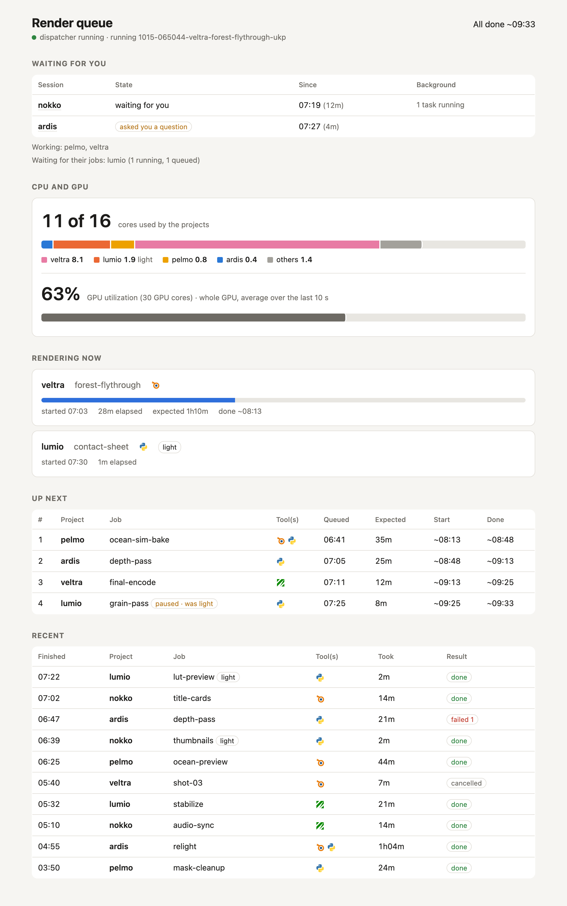

# render-queue

`rq` lets several [Claude Code](https://claude.com/claude-code) sessions share one Mac for rendering, each working on
its own project. Heavy jobs run strictly one at a time, first come first served. Short light jobs run next to them at
low priority, and heavy work started outside the queue holds it up instead of slowing everything down unnoticed. A
local status page shows the queue with expected start and end times, the CPU cores each project uses, the GPU load and
which sessions are waiting for you.



## Setup

You talk to two kinds of Claude Code sessions: one **queue session**, which keeps the queue running and makes the
queue decisions you hand it, and one **render session** per project, which submits its renders to the queue instead
of starting them itself.

### Requirements

- macOS. rq uses `caffeinate` (keeps the Mac awake while a job runs), `ioreg` (GPU load, no admin rights needed),
  `lsof` and `ps` (which project a process belongs to, work outside the queue) and `/bin/zsh` (runs job commands).
- Python 3 at `/usr/bin/python3` (it comes with the Xcode Command Line Tools), standard library only.
- Claude Code. The "Waiting for you" list reads the sessions' transcripts under `~/.claude/projects/`.

### Folder layout

Put your projects side by side with the `render-queue` folder, in one root folder. The folder directly under that
root is a job's project everywhere: on the status page, in job ids and in the core usage.

```
~/renders/
  render-queue/      this repository
  project-a/         one render session per project, started in this folder
  project-b/
```

If your projects live somewhere else, set `RQ_ROOT` to the folder that contains them, for the dispatcher and the
render sessions alike.

### 1. The queue session

A Claude Code session in the `render-queue` folder. It runs no renders itself.

1. Clone this repository into your projects' root and start a Claude Code session in it. Tell it its job, for
   example:

   > You are the queue session for rq, the render queue in this folder. Read README.md. You run no renders yourself.
   > Start the dispatcher, keep it running, and change the queue (rq move, cancel, pause, resume, keep, estimate)
   > only when I ask, or when a render session passes on my "go" for one of its jobs.

2. It starts the dispatcher: `./rq start`. The dispatcher runs detached, so it outlives the session that started it,
   and only one can run at a time. After a restart of the Mac, start it again.
3. Open the status page: http://localhost:8642 (local only; `rq start --port N` for another port).
4. Optional, once the render sessions are running (step 2): have it write `state/sessions.json`, the sessions to
   watch for "Waiting for you": every project folder name, with a link that opens its session if you have one (for
   example from the Claude desktop app), else `null`:

   ```json
   {
     "project-a": "claude://...",
     "project-b": null
   }
   ```

   The page then shows when a session's turn has ended, when it asked you a question or when a tool call may wait
   for your permission. A session with jobs in the queue waits for them, not for you. This works best with sessions
   in the Claude desktop app, where rq finds each session's process; otherwise it reads the project's newest
   transcript only. Without `sessions.json`, the page leaves "Waiting for you" out.

From then on you tell the queue session what to change, and it runs:

| You say | It runs |
| --- | --- |
| "go" for a queued job | `rq move ID first` (it runs next) |
| a running light job may run longer than 5 minutes | `rq keep ID` (before the 5 minutes are up) |
| a job will take longer or shorter | `rq estimate ID 2h` |
| stop a job | `rq cancel ID` |
| hold a running job, keeping its turn | `rq pause ID`, later `rq resume ID` |
| a running light job should wait its turn | `rq move ID queue` |

### 2. The render sessions

Start one Claude Code session per project, in the project's folder (that is how rq and the transcripts know which
project a session is). Give each the rules below: paste them into the project's `CLAUDE.md` and replace
`/path/to/render-queue` with your path. Not into `~/.claude/CLAUDE.md`: the queue session would get them too, and
they tell it not to change the queue. The render sessions need to be allowed to write to
`/path/to/render-queue/state`: if a sandbox blocks it, allow that folder.

```markdown
## Render queue

This machine is shared with other sessions through one render queue: heavy jobs run one at a time.

- Submit every heavy job (anything over 5 minutes: renders, encodes, bakes, simulations) with `rq run`, as a
  background task, from the project folder:
  `/path/to/render-queue/rq run --name NAME --estimate 45m -- COMMAND`
  It waits for its turn, runs the command in this folder and environment, streams its output into the task output
  and exits with the job's exit code. Stopping the task cancels the job. A single command argument runs through
  `/bin/zsh -c`.
- Always pass `--estimate` (e.g. `45m`, `2h30m`): the status page's times depend on it.
- Freeze what a queued job runs: commit first and run it from a snapshot of that commit (e.g. `git worktree add`),
  so later edits don't change a queued job. From a snapshot outside the project folder, pass `--project NAME`.
- Light work under 5 minutes (stills, tests, previews) goes through `rq light`, also as a background task:
  `/path/to/render-queue/rq light --name NAME -- COMMAND`
  Light jobs run one at a time at low priority next to the heavy job, so one may wait for its turn. One that runs
  past 5 minutes is paused and moved into the queue, and continues when it's its turn.
- Never run renders, Blender, ffmpeg or other heavy work outside rq: it holds up the whole queue.
- Tell me the job id when you queue a job. `/path/to/render-queue/rq status` shows its position and expected
  times; the status page is http://localhost:8642.
- Don't wait for other sessions, read their transcripts or check their processes: the queue does that.
- Don't reorder the queue yourself. If I say "go" for a job, ask the queue session to move it first (or tell me to).
  Only I decide whether a light job may run longer than 5 minutes.
- Pause or stop only your own processes, by exact PID, and leave no processes behind when a job is done.
- If rq says the dispatcher isn't running, tell me; don't start it yourself, the queue session does.
```

### 3. Daily use

- Ask a render session for a render as usual ("render the final cut"). It queues the job, tells you the id and gets a
  notification when the job is done.
- Watch the status page: what renders now, the queue with expected start and end times, cores per project, the GPU,
  work outside the queue that holds it up, and the sessions waiting for you (click one to open it).
- Tell the queue session when you want to change the order or a job: "go for ID", "cancel ID", "let ID run on",
  "ID will take 2h". After a restart: "start the dispatcher".
- To change a rule for all render sessions, change the snippet in their `CLAUDE.md`, or ask the queue session to send
  the change to them if your sessions can message each other.

## How jobs run

- `rq run` waits for its turn, then runs the command in the current folder and environment (so the session's sandbox
  applies). It streams the job's output live and exits with the job's exit code. A single command argument runs
  through `/bin/zsh -c`, several run as an argument list.
- `--estimate` (e.g. `45m`, `2h30m`) feeds the status page's times; `rq estimate ID 90m` sets it later. Without it,
  the median of earlier successful runs with the same project and name is used. A job with neither shows unknown
  times, and so does every job after it.
- `--project` defaults to the project folder you are in.
- Stopping the `rq run` process (or the background task running it) cancels the job, queued or running.
- **Light work** (`rq light`) has its own queue: one light job at a time, first come first served, next to the heavy
  job (the two queues don't wait for each other). It runs at low priority (`nice -n 10`), streams its output the same
  way and shows on the status page under "Rendering now". It never holds up the main queue.
- Light work is capped at 5 minutes. A light job that runs longer is paused where it is and moved to the end of the
  queue as a heavy job; it continues, with its progress, when it's its turn (the status page marks it "paused · was
  light"). `rq keep ID` before the 5 minutes are up lets it run on; once it is paused, `rq move ID first` makes it the
  next job.
- **Work outside the queue:** a busy or paused Blender or ffmpeg anywhere on the machine, or any other process group
  in a project folder (or its Claude Code scratchpad) that uses more than about one core at normal priority, holds up
  the queue until it has ended, and the status page names it. Heavy low-priority work outside rq is shown but doesn't
  hold the queue. The next job starts only after 2 minutes without outside work, also right after the dispatcher
  starts.

## Commands

```
rq run --name NAME [--project P] [--estimate 90m] -- COMMAND...
rq light --name NAME [--project P] -- COMMAND...   (light work: the light queue, one at a time, at nice 10)
rq status [--json]
rq log ID [-n 40] [-f]
rq cancel ID
rq pause ID / rq resume ID   (stop or continue the job's processes; it keeps its turn)
rq move ID first             (when the user says go: this queued job runs next)
rq move ID queue             (pause a running light job, move it to the end of the main queue)
rq keep ID                   (when the user says so: this light job may run longer than 5 minutes)
rq estimate ID 90m           (set or correct a job's expected duration)
rq start [--port 8642]       (start the dispatcher and the status page detached, one per machine)
rq daemon [--port 8642]      (the same in the foreground)
```

IDs can be shortened to any part that matches only one job, finished jobs included (`rq status` lists the ids).

## Status page

http://localhost:8642 shows which sessions are waiting for you, the cores each project uses (in total and per
project), the GPU utilization, the running job and light work, the queue with expected start and end times, heavy
work outside rq, and recent jobs with how long they took. It listens on 127.0.0.1 only and shows no job output.

## How it works

- `state/` (not in git) holds one JSON file per job, the logs, the current turns and the dispatcher's heartbeat.
- The dispatcher checks every 2 s. When nothing is granted, it gives the turn to the first job in the queue (the
  oldest, unless one was moved first), once no heavy work at normal priority has been busy or paused outside the
  queue for 2 minutes.
- The `rq run` client of that job starts the command in a new process group (with `caffeinate -i`) and records the
  result. If a client dies, its job keeps the turn until its processes have ended, then it counts as lost.
- Every 5 s the dispatcher reads the tail of each watched session's transcript (and checks its Claude process) to show
  which sessions wait for you: their turn ended, they asked a question, or a tool call may wait for permission. Turns
  that only answered another session are skipped, and a session with jobs in rq waits for them, not for you.
- When a job is submitted, rq records which of Blender, Python and ffmpeg it runs: from the command and the scripts it
  starts (two levels deep). The status page shows them as logos in the Tool(s) column.
- Cores per project come from `ps` and each process's working directory (or a parent's) under the projects' root, or
  its Claude Code scratchpad.

## Configuration

| Variable | Default | Read by | What it is |
| --- | --- | --- | --- |
| `RQ_ROOT` | the folder that contains `render-queue` | the dispatcher, `rq run`, `rq light` | where the projects are |
| `RQ_STATE` | `render-queue/state` | every rq command | jobs, logs, the dispatcher's state, `sessions.json` |
| `RQ_LIGHT_CAP` | `300` | `rq light` | seconds a light job may run before it moves into the queue |
| `RQ_QUIET_WINDOW` | `120` | the dispatcher | seconds without outside work before the next job starts |

Set `RQ_ROOT` and `RQ_STATE` the same for the queue session, which starts the dispatcher (it inherits the session's
environment) and runs the queue commands, and for the render sessions: in the `env` of `.claude/settings.json` in the
`render-queue` folder and in each project folder. The dispatcher reads its variables when it starts: to change them,
stop it (`kill` the pid that `rq start` prints, also in `state/dispatcher.json`) and run `rq start` again. Jobs keep
running meanwhile.

## License

MIT
